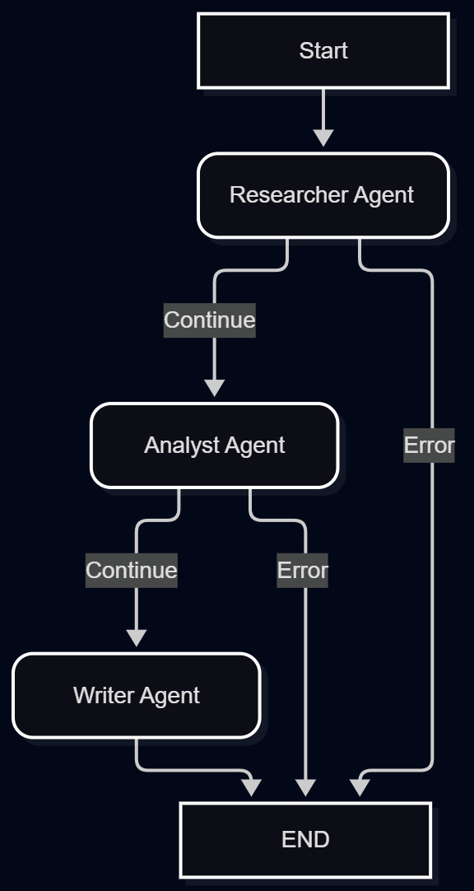

# OrchestrAI 🧠

OrchestrAI es un sistema multi-agente de investigación y generación de contenido construido con LangGraph, LangChain y Ollama. El sistema orquesta un equipo de agentes (Investigador, Analista y Redactor) para transformar un tópico simple en un reporte final estructurado, con resiliencia ante fallos, evaluación offline y caching semántico.

🎯 Características Principales (Los 7 Hitos)
Este proyecto fue construido de forma progresiva consolidando conceptos avanzados de arquitectura de agentes:

Grafos y Estado Compartido (LangGraph): Orquestación de agentes mediante nodos y aristas en un grafo de estado.

Paso de Mensajes: Los agentes se comunican inyectando y leyendo información de un PipelineState compartido.

Checkpointing: Uso de SqliteSaver para guardar el estado en cada paso, permitiendo recuperación ante fallos y Human-in-the-loop.

Pipeline de Evals Offline: Sistema propio para evaluar la calidad de las respuestas usando un LLM como juez (LLM-as-a-judge) y validación de keywords.

Logging y Métricas: Trazabilidad completa de las ejecuciones estructurada en archivos y consola.

Caching Semántico: Implementación de caché con Redis y SentenceTransformers para evitar ejecuciones redundantes si la consulta es semánticamente similar.

Dockerización: Todo el stack (App, Redis, Base de Datos) orquestado con Docker Compose.

🏗️ Arquitectura del Grafo
El flujo del pipeline sigue una estructura lineal con control de errores:

  

📦 El Estado (PipelineState)
El corazón del sistema es el estado que viaja a través de los nodos:

python
from typing import TypedDict, Optional, List

class PipelineState(TypedDict):
    topic: str                          # Tema pedido por el usuario
    research_results: Optional[str]     # Output del Investigador
    analysis: Optional[str]             # Output del Analista
    final_report: Optional[str]         # Output del Escritor
    current_step: str                   # Paso actual del pipeline
    errors: List[str]                   # Errores acumulados
    trace_id: str                       # ID de rastreo para el pipeline
📁 Estructura del Proyecto

text
OrchestrAI/
├── domain/
│   ├── agents/            # Lógica de los agentes (researcher, analyst, writer)
│   ├── core/
│   │   ├── logging_config.py  # Configuración de logs
│   │   └── semantic_cache.py  # Implementación de caché con Redis
│   ├── state.py           # Definición del PipelineState (TypedDict)
│   └── evals/             # Pipeline de evaluación
│       ├── dataset.py     # Casos de prueba
│       ├── judge.py       # LLM evaluador
│       └── runner.py      # Ejecutor de las evaluaciones
├── graph/
│   └── pipeline.py        # Construcción del grafo y checkpointer
├── logs/                  # Archivos de log generados
├── Dockerfile
├── docker-compose.yml
├── checkpoints.db         # Base de datos SQLite (generada automáticamente)
├── main.py                # Punto de entrada
└── requirements.txt
🚀 Instalación y Uso
1. Requisitos Previos
Python 3.11 o 3.12 (evitar 3.13+).

Docker y Docker Compose.

Ollama instalado y corriendo en tu máquina con el modelo llama3.2 descargado (ollama pull llama3.2).

2. Configuración Local
bash
# Clonar y entrar al proyecto
git clone <url-del-repo>
cd OrchestrAI

# Crear entorno virtual (usando Python 3.12)
py -3.12 -m venv venv
venv\Scripts\activate  # En Windows
source venv/bin/activate # En Linux/Mac

# Instalar dependencias
pip install -r requirements.txt

# Levantar Redis para el caché semántico
docker run -d --name orchesttrai-redis -p 6379:6379 redis:7-alpine
3. Ejecutar el Pipeline
El archivo main.py incluye la ejecución del pipeline y la demostración del caché semántico:

bash
python main.py
Verás cómo la primera consulta ejecuta todo el grafo y guarda el checkpoint en SQLite, y la segunda consulta semánticamente similar recupera la información de Redis en milisegundos.

4. Levantar Todo el Stack con Docker
Para levantar la aplicación junto con Redis y PostgreSQL en contenedores aislados:

bash
docker compose up -d --build
Revisar logs en tiempo real:

bash
docker compose logs -f app
🧪 Pipeline de Evaluación (Evals)
El proyecto incluye un sistema de evaluación offline para medir la calidad de los reportes generados. Funciona en dos partes:

Keyword Matching (runner.py): Verifica que el reporte final contenga las palabras clave esperadas definidas en el dataset.

LLM-as-a-Judge (judge.py): Utiliza una instancia de OllamaLLM para actuar como evaluador experto. Le asigna un puntaje del 1 al 10 al reporte en cuatro criterios:

Relevancia: ¿Responde al tema solicitado?

Precisión: ¿La información es correcta y clara?

Estructura: ¿Tiene una organización lógica?

Fluidez: ¿Es fácil de leer?

El juez devuelve un objeto estructurado con Pydantic (EvalResult) que determina si el reporte pasa el umbral mínimo (min_score).

Para correr las evaluaciones:

bash
python -m evals.runner
🧠 Sobre el Caché Semántico
El sistema utiliza all-MiniLM-L6-v2 para generar embeddings de las consultas. Al recibir un nuevo tópico, calcula la similitud de coseno contra los embeddings guardados en Redis. Si la similitud es mayor al umbral (0.85), devuelve el resultado cacheado evitando gastar tokens y tiempo de cómputo en el pipeline.

🛠️ Tecnologías Utilizadas
LangGraph & LangChain: Orquestación de agentes y LLMs.

Ollama: Ejecución local del modelo Llama 3.2.

Redis: Base de datos en memoria para el caché semántico.

SQLite: Persistencia de checkpoints del grafo.

SentenceTransformers: Generación de embeddings.

Docker: Contenerización del ecosistema.

Pydantic: Validación de datos y estructuras de salida.